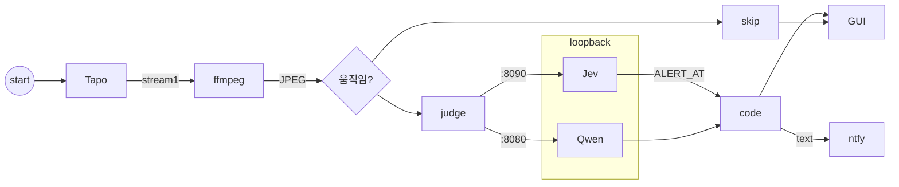

# baby-monitor

아기 침대 카메라를 보고, 위험해 보이면 ntfy로 글자를 보냅니다. 실험용입니다. 의료기기로 쓰지 마세요.



ffmpeg가 Tapo RTSP에서 JPEG를 한 장 뜹니다. 직전 장과 움직임이 다르거나, 한동안 판정을 안 했으면 로컬 모델이 장면을 봅니다. 기본은 Jev(8090)이고 Qwen(8080)으로 바꿀 수 있습니다. 입코가 가려졌거나, 난간에 올랐거나, 침대가 비었다고 나오면 알림이 갑니다. 창에도 나오고, 이 폴더에 기록합니다.

Windows에서만 됩니다. RTSP가 되는 Tapo와 PATH의 ffmpeg가 필요하고, 모델 파일은 [RUNTIME.txt](RUNTIME.txt)를 보면 됩니다.

`rtsp.env.example`을 복사해 `rtsp.env`를 만들고 카메라 값을 넣습니다. 알림은 `ntfy.env.example`을 `ntfy.env`로 복사한 뒤 토픽을 넣으면 됩니다.

```bash
python crib_gui.py
```

라이선스는 MIT입니다. 전문은 [LICENSE](LICENSE)에 있습니다.


