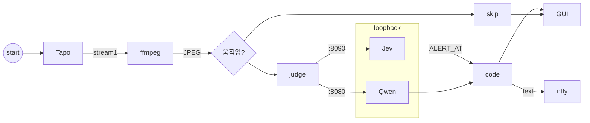

# baby-monitor

로컬에서 돌아가는 아기 침대 감시 프로그램입니다.  
**실험용이며, 의료기기가 아닙니다.**

Tapo 카메라의 RTSP 스트림에서 화면을 받아 움직임이 있으면 로컬 AI 모델로 판정하고, 위험하다고 판단되면 ntfy로 알림을 보냅니다.



## 어떻게 동작하나

1. `ffmpeg`로 카메라에서 사진 한 장을 가져옵니다.
2. 이전 사진과 비교해서 움직임이 있는지 확인합니다.
3. 움직임이 있거나, 일정 시간이 지나면 모델에게 판정을 요청합니다.
   - 기본 모델: Jev (포트 8090)
   - 대안 모델: Qwen (포트 8080)
4. 얼굴이 가려졌거나, 난간에 올라갔거나, 아기가 없을 때 등 위험하다고 판단되면 알림을 보냅니다.
5. 결과는 화면에 표시되고, 로컬에 기록됩니다.

## 필요한 것

- Windows PC (Python 3.10+)
- RTSP를 지원하는 Tapo 카메라
- `ffmpeg`가 설치되어 있고 PATH 환경변수에 등록되어 있어야 합니다.
- 로컬 AI 모델 런타임 파일 (`runtime/` 디렉터리 구성, 상세 내용은 `RUNTIME.txt` 참고)

## 설정 방법

1. **파이썬 의존 패키지 설치**
   ```bash
   pip install -r requirements.txt
   ```
2. **카메라 RTSP 설정**  
   `rtsp.env.example` 파일을 복사하여 `rtsp.env`로 만든 뒤, 카메라 접속 정보를 입력합니다.
3. **푸시 알림 설정 (선택 사항)**  
   알림을 받으려면 `ntfy.env.example`을 `ntfy.env`로 복사하고, ntfy 토픽을 설정합니다.

## 실행 방법

### 1. GUI 실행 (권장)
가장 간단한 방법은 GUI를 띄우는 것입니다. GUI 내에서 선택한 모델 서버(Jev 또는 Qwen)와 감시 프로세스를 함께 시작하고 화면을 확인할 수 있습니다.

```bash
python crib_gui.py
```

### 2. CLI 단독 실행
모델 서버가 이미 구동 중인 상태에서 터미널로 감시 루프만 돌릴 수도 있습니다.

```bash
python watch.py --rtsp
```
